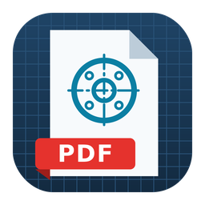

<p align="center"></p>

# DXF to PDF

A portable desktop app that turns a DXF drawing into a vector PDF and opens it. Drop the file in, and the PDF opens in your default viewer a moment later. Nothing is uploaded; the conversion runs on your computer.

## Download

Grab a build from the [Releases](../../releases) page:

- **Windows:** `DXF-to-PDF-x.y.z-portable.exe` runs without installing. Copy it to a USB stick or any folder and double-click. `DXF-to-PDF-x.y.z-setup.exe` installs it and lets you double-click `.dxf` files to open them in the app.
- **Linux:** `DXF-to-PDF-x.y.z.AppImage` (make it executable, then run).
- **macOS:** `DXF-to-PDF-x.y.z.dmg` (unsigned: right-click the app, then Open, the first time).

## What the PDF keeps

- Every line, arc and curve as vector paths, so it stays sharp at any zoom or print size
- Line weights, line types (dashed, center, hidden) and colours from the drawing
- Hatch patterns as real pattern lines, solid fills as fills
- Text position, height, rotation, alignment and width factor; MTEXT wraps like in CAD
- Blocks, attributes, dimensions and leaders

Full list and current limits: [docs/supported-dxf.md](docs/supported-dxf.md).

## Use it

1. Open the app and drop a `.dxf` file on it, choose **Choose file**, or press Ctrl+O.
2. The PDF opens automatically. Turn this off with the checkbox on the start screen.
3. Change page size (A4 to A0, Letter, Tabloid), orientation, colour or all-black lines, and layers; the preview and PDF update together.
4. **Save PDF…** writes it next to the DXF by default.

You can also start it with a file: `"DXF to PDF.exe" drawing.dxf`.

## Develop

Needs Node.js 20 or newer.

```bash
npm install
npm start          # run the app
npm test           # unit tests for the converter
npm run dist:win   # Windows portable + installer in dist/
```

Pushing a tag such as `v1.0.0` makes GitHub Actions build Windows, Linux and macOS packages and attach them to a release. See [CLAUDE.md](CLAUDE.md) for the code layout.

## বাংলায় সংক্ষেপে

Windows-এ `DXF-to-PDF-...-portable.exe` ইনস্টল ছাড়াই চলে। অ্যাপ খুলে DXF ফাইল টেনে ছেড়ে দিন, PDF নিজে থেকেই খুলে যাবে। PDF পুরোটা ভেক্টর, তাই জুম বা প্রিন্টে মান কমে না। লাইন ওয়েট, লাইন টাইপ, হ্যাচ, ব্লক, ডাইমেনশন সব থাকে। ড্রয়িংয়ের বাংলা লেখা এখনো "?" দেখায়।

## Credits

Barlow and Barlow Condensed fonts by Jeremy Tribby, SIL Open Font License (`src/renderer/fonts/OFL.txt`). PDF output by [jsPDF](https://github.com/parallax/jsPDF) (MIT).
